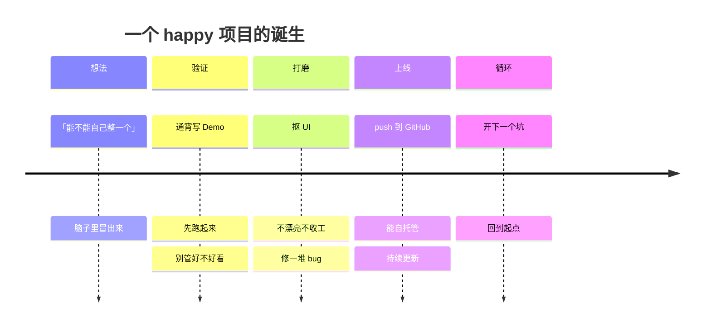
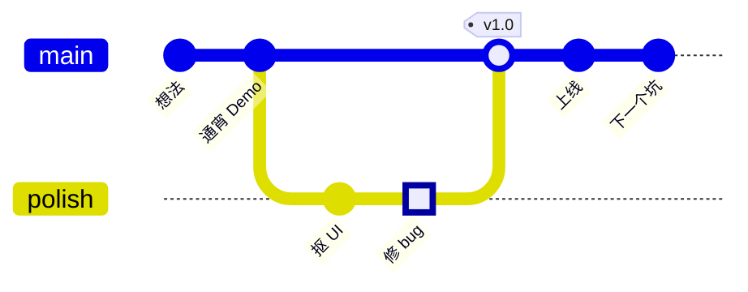
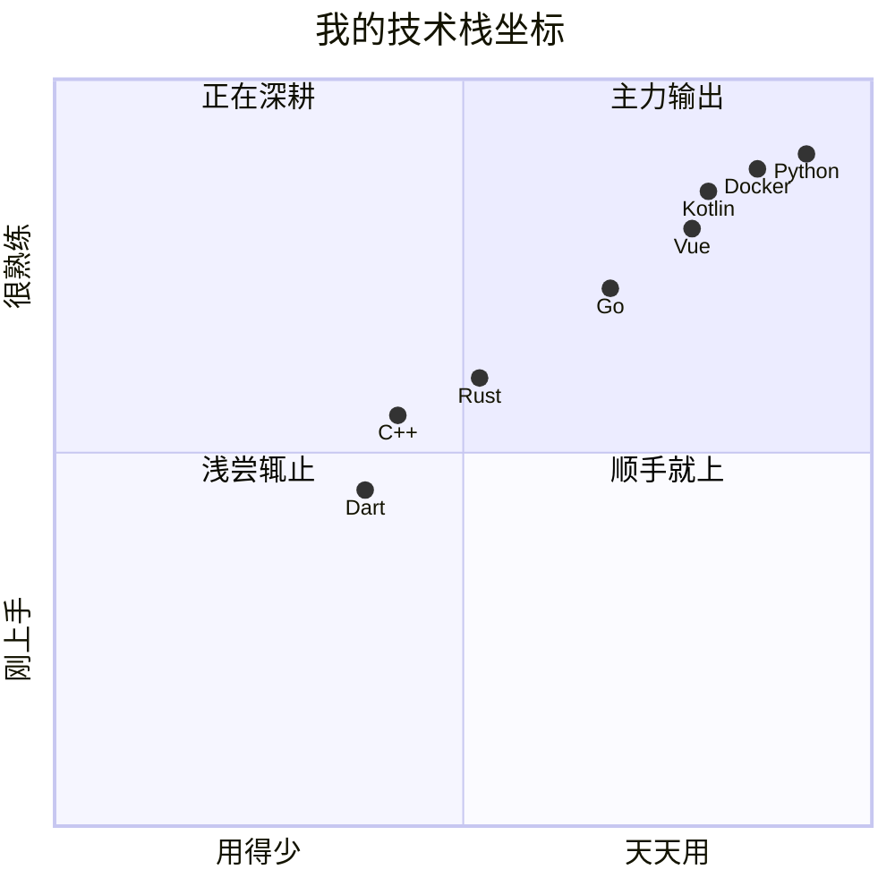
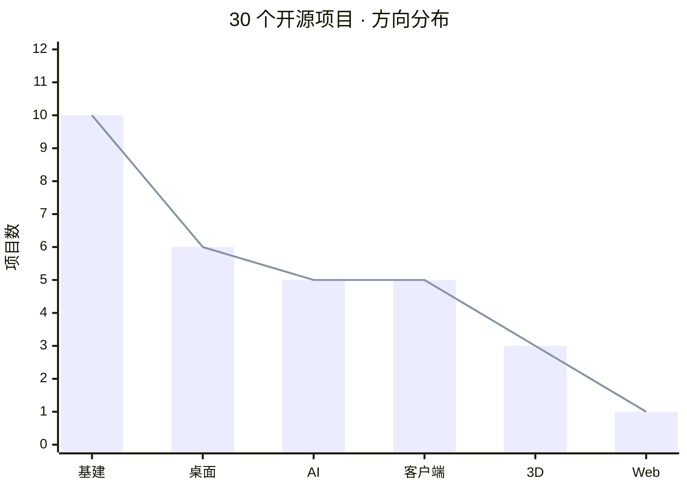
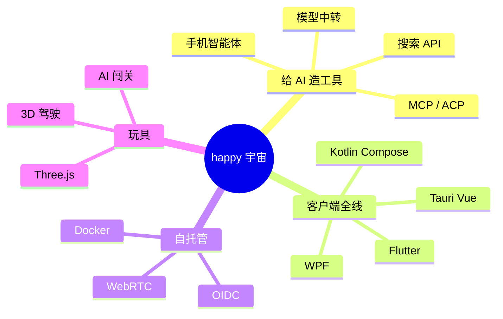
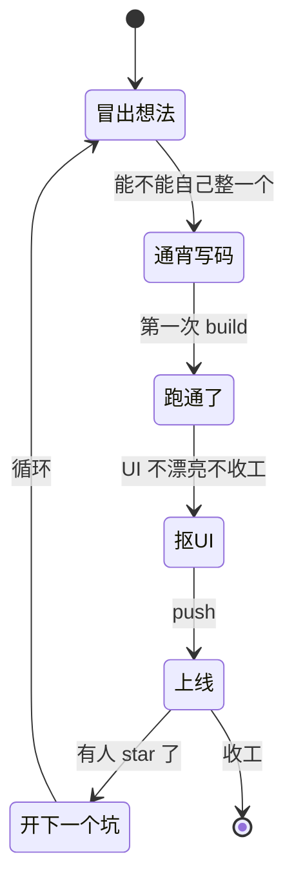
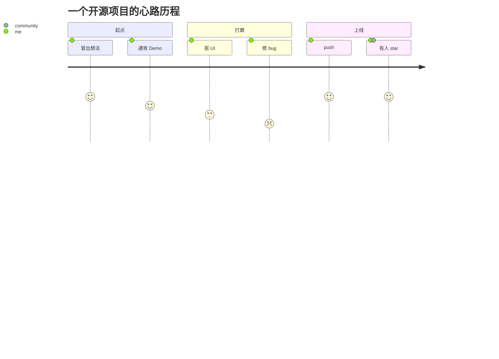
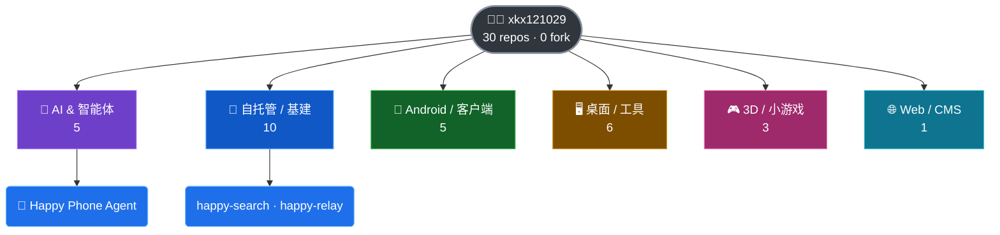
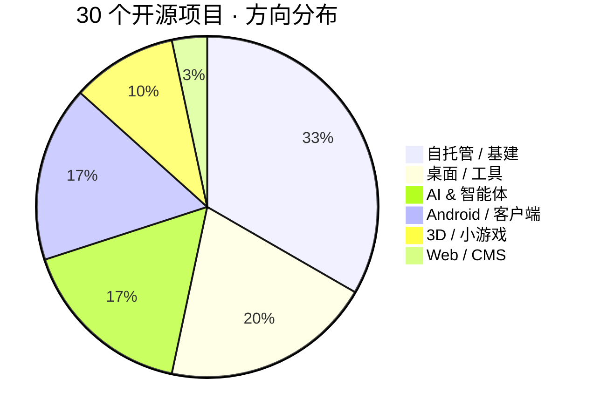

<p align="center">
  
</p>

<h1 align="center">👋 Hi, I'm xkx121029</h1>

<p align="center"><b>happy～happy～happy～　·　自托管玩家　·　什么都想自己整一个</b></p>

<p align="center">
  <a href="https://github.com/xkx121029/Phtomt"></a>
  
</p>

<p align="center">
  
  
  
  
  
  
  
</p>

<p align="center">
  <picture>
    <source media="(prefers-color-scheme: dark)" srcset="./assets/skillicons-dark.svg">
    <source media="(prefers-color-scheme: light)" srcset="./assets/skillicons-light.svg">
    
  </picture><br>
  <sub>↑ 双行图标条 · 跟着 GitHub 亮 / 暗主题自动换色</sub>
</p>

---

> [!IMPORTANT]
> ### 🚀 NOW
> **Happy Phone Agent** 已开源，正在打磨；**HappyClaw** 在整，路上。
>
> - [x] `Phtomt` → 能自己操控手机的 Android AI 智能体
> - [ ] `HappyClaw` → 下一个主推，仓库还没公开
>
> <sub>偏好很固定：<kbd>零依赖</kbd> <kbd>单文件</kbd> <kbd>双击即玩</kbd> <kbd>自己能托管</kbd></sub>

---

## 🎯 主推项目

<table>
  <tr>
    <td width="50%" align="center" valign="top">
      <a href="https://github.com/xkx121029/Phtomt"></a><br><br>
      <b>🤖 Happy Phone Agent</b><br><br>
      
      
      <br><br>
      基于 AI 的 Android 智能体，自动操控手机完成复杂任务。<br><br>
      <a href="https://github.com/xkx121029/Phtomt"><b>→ 打开仓库</b></a>
    </td>
    <td width="50%" align="center" valign="top">
      <br><br><br>
      <b>🦀 HappyClaw</b><br><br>
      
      <br><br>
      <sub>下一个主推项目 · 正在整</sub><br><br>
      <b>先占位，不编链接</b><br>
      <sub>GitHub 上暂时查不到公开仓库，开源了立刻补上真实地址</sub><br><br>
      🧩 ⚙️ 🛠️ 🧠 🔧
      <br><br><br><br><br><br>
    </td>
  </tr>
</table>

<sub>封面是 GitHub 官方生成的仓库社交预览卡（含描述 / star / fork），点图直达仓库，每 6 小时自动刷新。</sub>

---

## 🖼 项目掠影

<table>
  <tr>
    <td align="center" width="50%">
      <a href="https://github.com/xkx121029/happy-search"></a><br>
      <b>🔍 happy-search</b> · <sub>多引擎聚合搜索 API</sub>
    </td>
    <td align="center" width="50%">
      <a href="https://github.com/xkx121029/happy-relay"></a><br>
      <b>🔁 happy-relay</b> · <sub>OpenAI 兼容模型中转</sub>
    </td>
  </tr>
  <tr>
    <td align="center" width="50%">
      <a href="https://github.com/xkx121029/AioShell"></a><br>
      <b>🐚 AioShell</b> · <sub>带 MCP / ACP 的工作区</sub>
    </td>
    <td align="center" width="50%">
      <a href="https://github.com/xkx121029/happy-cloud"></a><br>
      <b>☁️ happy-cloud</b> · <sub>私有云盘</sub>
    </td>
  </tr>
</table>

---

## 👋 关于我

大连，一个人把想法从 0 整到能跑。30 个开源项目，几乎全是从零起的，**名字基本都以 happy 开头**。

> [!TIP]
> **「能不能自己整一个？」——能，就整了。**

- 🧠 **给 AI 造工具**：自托管搜索 API（14 引擎聚合 + RRF 融合排序）、OpenAI 兼容模型中转、内置 MCP / ACP 的网盘工作区、能自己操控手机的 Android 智能体
- 📱 **客户端全线**：Kotlin / Jetpack Compose、C# / WPF、Tauri 2 + Vue、Flutter、纯 Rust 写的 Windows TSF 编程输入法
- 🖥 **自托管 & 运维**：私有云盘、统一身份枢纽（OIDC / Ed25519 / WebRTC 信令）、ARM64 上用 Docker + QEMU 跑 Windows
- 🎮 **也写玩具**：Three.js 单文件 2.5D 农场、3D 自动驾驶训练、AI 闯关、代码动画生成器
- 🧩 先跑通再抠体验，**UI 不漂亮不收工**

---

## 🧰 技术栈

        

| 领域 | 用到的东西 |
| :--- | :--- |
| **AI / 给 AI 用的基建** | 零 API Key 搜索 API（14 引擎 + RRF 融合排序）、OpenAI 兼容中转、MCP / ACP / REST 端点、OIDC / Ed25519 许可证、WebRTC 信令 |
| **后端** | Python、Go（单文件二进制 + 内嵌 Web 面板）、Node.js（含 `node:sqlite`）、Gin |
| **桌面 / 移动** | Kotlin + Jetpack Compose、C# / WPF（.NET 8 + SkiaSharp）、Tauri 2 + Vue、Flutter / Dart、Rust + `windows-rs`、C++ |
| **前端 / 3D** | HTML / JS / TS、Three.js、WebView、纯前端零构建、React + Vite + TailwindCSS |
| **基建运维** | Docker、ARM64、QEMU + QMP + noVNC、P2P / 局域网同步、私有云、WebRTC |
| **代码工具** | Compose 源码 → 统一 IR → 浏览器渲染、代码 → 编写动画 → 导出视频 |

---

> [!NOTE]
> ### 🎨 程序化图表长廊
> 下面这些**全是 GitHub 原生 Mermaid 矢量图**——由代码和数据生成，跟着明暗主题变色，不是图片、不会裂、放大不糊。点开折叠逐个看。

<details open>
<summary>🕰 时间线 · 一个 happy 项目是怎么诞生的</summary>



</details>

<details>
<summary>🔀 Git 提交图 · build → ship → repeat</summary>



</details>

<details>
<summary>🎯 四象限 · 技术栈坐标</summary>



</details>

<details>
<summary>📊 柱状图 + 折线 · 30 个项目的方向分布</summary>



</details>

<details>
<summary>🧠 思维导图 · happy 宇宙全景</summary>



</details>

<details>
<summary>🔄 状态机 · 从想法到开下一个坑</summary>



</details>

<details>
<summary>🛤 旅程图 · 一个开源项目的心路历程</summary>



</details>

<details>
<summary>🌊 桑基图 · 技术栈流向</summary>

```mermaid
sankey-beta
    Python,自托管基建,8
    Go,自托管基建,5
    Kotlin,客户端全线,6
    Vue,桌面工具,4
    Rust,桌面工具,3
    JavaScript,Web 与 3D,3
```

</details>

---

## 📊 数据 & 项目版图


| 方向 | 密度 | 数量 | 走势 |
| :--- | :--- | ---: | :--- |
| 🔧 自托管 / 基建 | `████████████████████` | **10** | `▁▂▃▅▆▇█▆` |
| 🖥 桌面 / 工具 | `████████████░░░░░░░░` | **6** | `▂▄▆█▆▄▂` |
| 🤖 AI & 智能体 | `██████████░░░░░░░░░░` | **5** | `▁▃▅▇▅▃▁` |
| 📱 Android / 客户端 | `██████████░░░░░░░░░░` | **5** | `▂▄▆▆▄▂▁` |
| 🎮 3D / 小游戏 | `██████░░░░░░░░░░░░░░` | **3** | `▁▂▄▃▂▁▁` |
| 🌐 Web / CMS | `██░░░░░░░░░░░░░░░░░░░░` | **1** | `▁▁▂▁▁▁▁` |

<details>
<summary>🗺 项目版图（Mermaid flowchart）</summary>



</details>

<details>
<summary>🥧 展开看方向占比（Mermaid 饼图）</summary>



</details>

---

## 📦 全部项目

<details>
<summary>🤖 AI & 智能体 · 5</summary>

[Phtomt](https://github.com/xkx121029/Phtomt) · [AioShell](https://github.com/xkx121029/AioShell) · [HappyBrowser](https://github.com/xkx121029/HappyBrowser) · [happy_android_ai_see](https://github.com/xkx121029/happy_android_ai_see) · [runtime-console](https://github.com/xkx121029/runtime-console)

</details>

<details>
<summary>🔧 自托管 / 基建 · 10</summary>

[happy-search](https://github.com/xkx121029/happy-search) · [happy-relay](https://github.com/xkx121029/happy-relay) · [happy-one](https://github.com/xkx121029/happy-one) · [wharf](https://github.com/xkx121029/wharf) · [happy_html_puter](https://github.com/xkx121029/happy_html_puter) · [happy-app-market](https://github.com/xkx121029/happy-app-market) · [happy-cloud](https://github.com/xkx121029/happy-cloud) · [happy-linux-win](https://github.com/xkx121029/happy-linux-win) · [happy_yuankong](https://github.com/xkx121029/happy_yuankong) · [xmtb](https://github.com/xkx121029/xmtb)

</details>

<details>
<summary>📱 Android / 客户端 · 5</summary>

[HappyLook](https://github.com/xkx121029/HappyLook) · [Clapper](https://github.com/xkx121029/Clapper) · [happy_andorid_html_quickook](https://github.com/xkx121029/happy_andorid_html_quickook) · [happy_potplayer](https://github.com/xkx121029/happy_potplayer) · [baike_reformat](https://github.com/xkx121029/baike_reformat)

</details>

<details>
<summary>🖥 桌面 / 工具 · 6</summary>

[happy_clean](https://github.com/xkx121029/happy_clean) · [happy-whiteboard](https://github.com/xkx121029/happy-whiteboard) · [happy_shurufa](https://github.com/xkx121029/happy_shurufa) · [exam-bell](https://github.com/xkx121029/exam-bell) · [kompose-studio](https://github.com/xkx121029/kompose-studio) · [code-reel](https://github.com/xkx121029/code-reel)

</details>

<details>
<summary>🎮 3D / 小游戏 · 3</summary>

[windfield-farm](https://github.com/xkx121029/windfield-farm) · [ai-chuangguan](https://github.com/xkx121029/ai-chuangguan) · [AI_car](https://github.com/xkx121029/AI_car)

</details>

<details>
<summary>🌐 Web / CMS · 1</summary>

[happy_home](https://github.com/xkx121029/happy_home)

</details>

<sub>🎯 主推另见上方双卡：Happy Phone Agent / Phtomt · HappyClaw（仓库待补）</sub>

---

## 📫 找得到我

> [!NOTE]
> 自托管、AI 基建、Android / 桌面、以及一切「能不能自己整一个」的话题，开 Issue 聊就行。

<table>
  <tr>
    <td align="center" width="33%"><a href="https://linshuxu.pages.dev"><b>🌐 个人站</b></a></td>
    <td align="center" width="33%"><a href="https://space.bilibili.com/3546846012115408"><b>📺 B 站</b></a></td>
    <td align="center" width="33%"><a href="https://qm.qq.com/q/e0EttbDdyU"><b>💬 QQ 号</b></a></td>
  </tr>
</table>

---

<div align="center">

<sub>⚡ 30 repos · mostly named happy · all built from scratch.</sub><br>
<sub>🟪 🟦 🟩 🟨 🟧 🟥　·　<kbd>build</kbd> <kbd>ship</kbd> <kbd>repeat</kbd></sub>

</div>

<!--
  【视觉】全部用 GitHub 原生能力 + ./assets/ 本地图片，不请求任何外链：
    - <picture> + prefers-color-scheme 让双行 skillicons 跟随亮/暗主题
    - 三行轮流打字机动效 typing.svg、for-the-badge 大徽章
    - GitHub 原生 Alert（IMPORTANT / TIP / NOTE）、任务列表、<kbd> 键帽
    - Mermaid 图表长廊：timeline / gitGraph / quadrantChart / xychart-beta / mindmap /
      stateDiagram-v2 / journey / sankey-beta + 原有 flowchart / pie，共 10 张，GitHub 网页端矢量渲染
    - HTML 表格做双列封面墙；等宽字符进度条 + sparkline 走势展示真实分组数量

  【持续更新】.github/workflows/refresh-assets.yml 每 6 小时（UTC 0/6/12/18）
  在 GitHub Actions 的境外 runner 上执行 scripts/refresh-assets.mjs：
    - 调 GitHub API 拿实时仓库数 / fork 数 / star 总数 -> 重生成 3 张数字徽章
    - 重抓 streak（radical 主题）、komarev 访客计数、GitHub 官方头像
    - 重抓 6 张官方仓库 OG 封面（含 happy-cloud，URL 带时间戳破缓存）
    - 内容有变化才写盘并提交；下载失败保留上一次成功的图片
    - 静态素材（双行图标条 / 三行打字机 / for-the-badge 徽章）只在缺失时补齐，URL 已同步新版
    - 图片后的 ?v= 是脚本维护的缓存版本号，用于破 GitHub 图片代理缓存，请勿手动删除

  【人工维护】正文里的「30 个项目」、分组数字（5/10/5/6/3/1）、字符进度条、sparkline
  与所有 Mermaid 图里的数据都是同一份分类快照，脚本不改正文文字，只更新徽章数字和图片。

  上线：把本目录全部内容（含 assets/、scripts/、.github/）作为 xkx121029/xkx121029 仓库根目录推送。
-->
