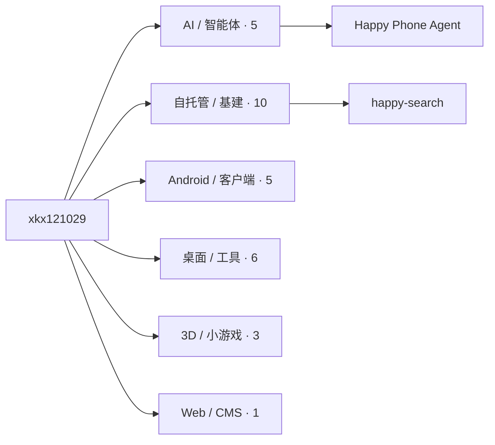

   
  

<h1 align="center">👋 Hi, I'm xkx121029</h1>

  
  
  
  
  
  
  

> **happy～happy～happy～　·　自托管玩家　·　什么都想自己整一个**

---

> [!IMPORTANT]
> 🚀 **NOW** · 正在推 **Happy Phone Agent** 和 **HappyClaw**

## 🎯 主推项目

### 🤖 Happy Phone Agent

  

基于 AI 的 Android 智能体，自动操控手机完成复杂任务。

**→ [github.com/xkx121029/Phtomt](https://github.com/xkx121029/Phtomt)** · ⭐ Star 数以仓库页为准

### 🦀 HappyClaw

 

> [!NOTE]
> 下一个主推项目，正在整。GitHub 上暂时查不到公开仓库，**先占位、不编链接**，开源了立刻补上。

---

## 🖼 项目掠影

  
  

  
  

↑ 图片是 GitHub 官方生成的仓库社交预览卡，点图直达仓库。已下载到本地，每 6 小时自动刷新。

---

## 👋 关于我

大连，一个人把想法从 0 整到能跑。30 个开源项目，几乎全是从零起的，**名字基本都以 happy 开头**。

- 🧠 **给 AI 造工具**：自托管搜索 API（14 引擎聚合 + RRF 融合排序）、OpenAI 兼容模型中转、内置 MCP / ACP 的网盘工作区、能自己操控手机的 Android 智能体
- 📱 **客户端全线**：Kotlin / Jetpack Compose、C# / WPF、Tauri 2 + Vue、Flutter、纯 Rust 写的 Windows TSF 编程输入法
- 🖥 **自托管 & 运维**：私有云盘、统一身份枢纽（OIDC / Ed25519 / WebRTC 信令）、ARM64 上用 Docker + QEMU 跑 Windows
- 🎮 **也写玩具**：Three.js 单文件 2.5D 农场、3D 自动驾驶训练、AI 闯关、代码动画生成器
- 🧩 偏好很固定：**零依赖、单文件、双击即玩、自己能托管**；先跑通再抠体验，UI 不漂亮不收工

> 一句话总结：**「能不能自己整一个？」——能，就整了。**

---

## 🧰 技术栈

       

| 领域 | 用到的东西 |
| :--- | :--- |
| **AI / 给 AI 用的基建** | 零 API Key 搜索 API（14 引擎 + RRF 融合排序）、OpenAI 兼容中转、MCP / ACP / REST 端点、OIDC / Ed25519 许可证、WebRTC 信令 |
| **后端** | Python、Go（单文件二进制 + 内嵌 Web 面板）、Node.js（含 `node:sqlite`）、Gin |
| **桌面 / 移动** | Kotlin + Jetpack Compose、C# / WPF（.NET 8 + SkiaSharp）、Tauri 2 + Vue、Flutter / Dart、Rust + `windows-rs`、C++ |
| **前端 / 3D** | HTML / JS / TS、Three.js、WebView、纯前端零构建、React + Vite + TailwindCSS |
| **基建运维** | Docker、ARM64、QEMU + QMP + noVNC、P2P / 局域网同步、私有云、WebRTC |
| **代码工具** | Compose 源码 → 统一 IR → 浏览器渲染、代码 → 编写动画 → 导出视频 |

---

## 📊 数据 & 项目版图

| 🤖 AI & 智能体 | 🔧 自托管 / 基建 |
| :---: | :---: |
| **5** 个项目 `Phtomt` · `AioShell` · `HappyBrowser` | **10** 个项目 `happy-search` · `happy-relay` · `happy-one` · `wharf` |

| 📱 Android / 客户端 | 🖥 桌面 / 工具 |
| :---: | :---: |
| **5** 个项目 `HappyLook` · `Clapper` · `happy_potplayer` | **6** 个项目 `happy_clean` · `happy_shurufa` · `exam-bell` |

| 🎮 3D / 小游戏 | 🌐 Web / CMS |
| :---: | :---: |
| **3** 个项目 `windfield-farm` · `AI_car` · `ai-chuangguan` | **1** 个项目 `happy_home` |

🗺 项目关系图（GitHub 网页端原生渲染，展开可见）

---

## 📦 全部项目

展开全部 30 个开源项目

**🎯 主推** · [Happy Phone Agent / Phtomt](https://github.com/xkx121029/Phtomt) · HappyClaw（仓库待补）

**🤖 AI & 智能体** · [Phtomt](https://github.com/xkx121029/Phtomt) · [AioShell](https://github.com/xkx121029/AioShell) · [HappyBrowser](https://github.com/xkx121029/HappyBrowser) · [happy_android_ai_see](https://github.com/xkx121029/happy_android_ai_see) · [runtime-console](https://github.com/xkx121029/runtime-console)

**🔧 自托管 / 基建** · [happy-search](https://github.com/xkx121029/happy-search) · [happy-relay](https://github.com/xkx121029/happy-relay) · [happy-one](https://github.com/xkx121029/happy-one) · [wharf](https://github.com/xkx121029/wharf) · [happy_html_puter](https://github.com/xkx121029/happy_html_puter) · [happy-app-market](https://github.com/xkx121029/happy-app-market) · [happy-cloud](https://github.com/xkx121029/happy-cloud) · [happy-linux-win](https://github.com/xkx121029/happy-linux-win) · [happy_yuankong](https://github.com/xkx121029/happy_yuankong) · [xmtb](https://github.com/xkx121029/xmtb)

**📱 Android / 客户端** · [HappyLook](https://github.com/xkx121029/HappyLook) · [Clapper](https://github.com/xkx121029/Clapper) · [happy_andorid_html_quickook](https://github.com/xkx121029/happy_andorid_html_quickook) · [happy_potplayer](https://github.com/xkx121029/happy_potplayer) · [baike_reformat](https://github.com/xkx121029/baike_reformat)

**🖥 桌面 / 工具** · [happy_clean](https://github.com/xkx121029/happy_clean) · [happy-whiteboard](https://github.com/xkx121029/happy-whiteboard) · [happy_shurufa](https://github.com/xkx121029/happy_shurufa) · [exam-bell](https://github.com/xkx121029/exam-bell) · [kompose-studio](https://github.com/xkx121029/kompose-studio) · [code-reel](https://github.com/xkx121029/code-reel)

**🎮 3D / 小游戏** · [windfield-farm](https://github.com/xkx121029/windfield-farm) · [ai-chuangguan](https://github.com/xkx121029/ai-chuangguan) · [AI_car](https://github.com/xkx121029/AI_car)

**🌐 Web / CMS** · [happy_home](https://github.com/xkx121029/happy_home)

---

## 📫 找得到我

- 🌐 **个人站** → <https://linshuxu.pages.dev>
- 📺 **B 站** → <https://space.bilibili.com/3546846012115408>
- 💬 **QQ 号** → <https://qm.qq.com/q/e0EttbDdyU>
- 💡 自托管、AI 基建、Android / 桌面、以及一切「能不能自己整一个」的话题，开 Issue 聊就行

---

⚡ 30 repos · mostly named happy · all built from scratch.

<!--
  素材全部来自 ./assets/，均为第三方服务生成的真实图片，已下载到本地，不依赖外链。

  【持续更新】.github/workflows/refresh-assets.yml 每 6 小时（UTC 0/6/12/18）
  在 GitHub Actions 的境外 runner 上执行 scripts/refresh-assets.mjs：
    - 调 GitHub API 拿实时仓库数 / fork 数 / star 总数 -> 重生成 3 张数字徽章
    - 重抓 streak-stats 连续提交卡、komarev 访客计数、GitHub 官方头像
    - 重抓 5 张官方仓库 OG 封面（URL 带时间戳破缓存）
    - 内容有变化才写盘并提交；下载失败保留上一次成功的图片
    - 图片后的 ?v= 是脚本维护的缓存版本号，用于破 GitHub 图片代理缓存，请勿手动删除
  也可在 Actions 页面手动 Run workflow，或本地执行 node scripts/refresh-assets.mjs。

  抓取失败并已放弃：capsule-render / github-readme-stats / activity-graph（vercel 系不通）、
  gh-card.dev、ghchart.rshah.org；头图 / 统计总卡 / 贡献图用 GitHub 原生 Alert + 表格 + Mermaid 顶替。

  【人工维护】正文里的「30 个项目」与项目版图分组数字（5/10/5/6/3/1）是分类快照，
  脚本不会自动改文字；新增仓库后如需精确，改这两处即可。徽章数字是自动的。

  上线：把本目录全部内容（含 assets/、scripts/、.github/）作为 xkx121029/xkx121029 仓库根目录推送，
  并在仓库 Settings → Actions → General → Workflow permissions 选 "Read and write permissions"。
-->
